# State machines

> GENERATED by `node gen-machine-docs.mjs` — do not edit.

All 13 state machines declared in `templates/states.yml` and `templates/machines/*.yml`. The YAML files are the source of truth; this page only mirrors them.

## Index

- [agent-inbox](#agent-inbox)
- [application-status](#application-status)
- [apply-gate](#apply-gate)
- [batch-job](#batch-job)
- [interview-round](#interview-round)
- [interview-round-outcome](#interview-round-outcome)
- [legitimacy-tier](#legitimacy-tier)
- [pdf-flag](#pdf-flag)
- [portal-health](#portal-health)
- [red-flag-level](#red-flag-level)
- [reply-candidate](#reply-candidate)
- [scan-history](#scan-history)
- [triage-verdict](#triage-verdict)

## agent-inbox

- **Id:** `agent-inbox`
- **Persisted in:** `` data/agent-inbox.md (checkbox of each `- [ ]` / `- [x]` line; override path with JOBBER_INBOX) ``
- **Initial state:** `Pending`
- **Writers:** `agent-inbox.mjs`
- **Policy:** `backward_between_live=forbidden`, `exit_terminal=force`, `unknown_input=reject`

### States

| Id | Label | Terminal | Aliases | Description |
|----|-------|----------|---------|-------------|
| `pending` | `Pending` | no | `[ ]` | Unchecked item. Created by `agent-inbox.mjs add`, by hand, or by a dashboard or script appending a line. Shown by `list`; the numbering `resolve N` uses |
| `resolved` | `Resolved` | yes | `[x]`, `x` | Checked item (the parser accepts x or X). `resolve N` flips [ ] to [x] and appends a `→ result` suffix when --result is given and no result suffix exists. Only `list --all` shows it. A person can still un-check it by hand; the script never does |

### Transitions

- `Pending` → `Resolved`
- `Resolved` → (terminal: no outgoing transitions)

### Diagram

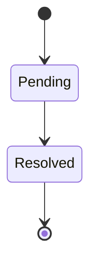

## application-status

- **Id:** `application-status`
- **Persisted in:** `data/applications.md (Status column) + data/status-log.tsv`
- **Initial state:** `Evaluated`
- **Writers:** `set-status.mjs`, `tracker-utils.mjs`, `reply-watch.mjs`, `merge-tracker.mjs`, `dedup-tracker.mjs`, `normalize-statuses.mjs`
- **Policy:** `backward_between_live=correction`, `exit_terminal=force`, `unknown_input=reject`

### States

| Id | Label | Terminal | Aliases | Description |
|----|-------|----------|---------|-------------|
| `evaluated` | `Evaluated` | no | `evaluada` | Offer evaluated with report, pending decision |
| `applied` | `Applied` | no | `aplicado`, `enviada`, `aplicada`, `sent` | Application submitted |
| `responded` | `Responded` | no | `respondido` | Company has responded (not yet interview) |
| `interview` | `Interview` | no | `entrevista` | Active interview process |
| `offer` | `Offer` | no | `oferta` | Offer received |
| `rejected` | `Rejected` | yes | `rechazado`, `rechazada` | Rejected by company |
| `discarded` | `Discarded` | yes | `descartado`, `descartada`, `cerrada`, `cancelada` | Discarded by candidate or offer closed |
| `skip` | `SKIP` | no | `no_aplicar`, `no aplicar`, `skip`, `monitor` | Doesn't fit, don't apply |
| `hired` | `Hired` | yes | `contratado`, `contratada`, `hired`, `accepted`, `accept` | Offer accepted, job landed! |

### Transitions

- `Evaluated` → `Applied`, `Responded`, `Rejected`, `Discarded`, `SKIP`
- `Applied` → `Responded`, `Interview`, `Rejected`, `Discarded`, `SKIP`
- `Responded` → `Interview`, `Rejected`, `Discarded`, `SKIP`
- `Interview` → `Offer`, `Rejected`, `Discarded`, `Hired`
- `Offer` → `Hired`, `Rejected`, `Discarded`
- `Rejected` → (terminal: no outgoing transitions)
- `Discarded` → (terminal: no outgoing transitions)
- `SKIP` → `Evaluated`, `Discarded`
- `Hired` → (terminal: no outgoing transitions)

### Diagram

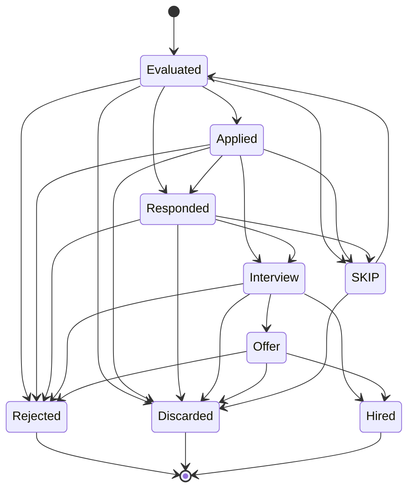

## apply-gate

- **Id:** `apply-gate`
- **Persisted in:** `prose only: modes/apply.md`
- **Initial state:** `filled`
- **Writers:** `apply`
- **Policy:** `backward_between_live=forbidden`, `exit_terminal=forbidden`, `unknown_input=reject`

### States

| Id | Label | Terminal | Aliases | Description |
|----|-------|----------|---------|-------------|
| `filled` | `filled` | no | (none) | Answers were written into the report's Application Answers section (State filled) and handed to the candidate for copy-paste or entered into the form. Nothing has been submitted. The agent stops here and waits for the candidate |
| `submitted` | `submitted` | yes | (none) | The candidate confirmed that they submitted the application. The user performs the submit action in the ATS, never the agent. Only then does the agent set the section to State submitted and run set-status Applied |

### Transitions

- `filled` → `submitted`
- `submitted` → (terminal: no outgoing transitions)

### Diagram

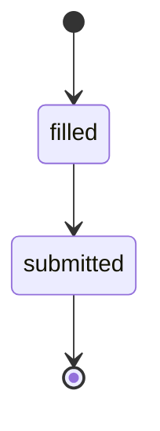

## batch-job

- **Id:** `batch-job`
- **Persisted in:** `batch/batch-state.tsv (status column)`
- **Initial state:** `Pending`
- **Writers:** `batch/batch-runner.sh`
- **Policy:** `backward_between_live=forbidden`, `exit_terminal=forbidden`, `unknown_input=reject`

### States

| Id | Label | Terminal | Aliases | Description |
|----|-------|----------|---------|-------------|
| `pending` | `Pending` | no | (none) | No row yet (or an explicit pending row); the offer is in batch-input.tsv but not started |
| `processing` | `Processing` | no | (none) | A report number is reserved and a worker is running. A row still here after the runner exited means the worker died |
| `rate_limited` | `Rate limited` | no | (none) | Worker hit a transient rate limit; the runner is sleeping before it retries. Like processing, it keeps its reserved report number |
| `paused_rate_limit` | `Paused (rate limit)` | no | (none) | Worker hit a session/usage limit; the batch stopped scheduling. Resumes only with --resume-paused |
| `failed` | `Failed` | no | (none) | Worker failed or no report was written. Retried by --retry-failed (or a normal run) while retries < max-retries |
| `skipped` | `Skipped` | yes | (none) | Report written but the score is below --min-score |
| `completed` | `Completed` | yes | (none) | Report written and verified on disk |

### Transitions

- `Pending` → `Processing`, `Failed`
- `Processing` → `Rate limited`, `Paused (rate limit)`, `Failed`, `Skipped`, `Completed`
- `Rate limited` → `Processing`, `Paused (rate limit)`, `Failed`, `Skipped`, `Completed`
- `Paused (rate limit)` → `Processing`, `Failed`
- `Failed` → `Processing`
- `Skipped` → (terminal: no outgoing transitions)
- `Completed` → (terminal: no outgoing transitions)

### Diagram

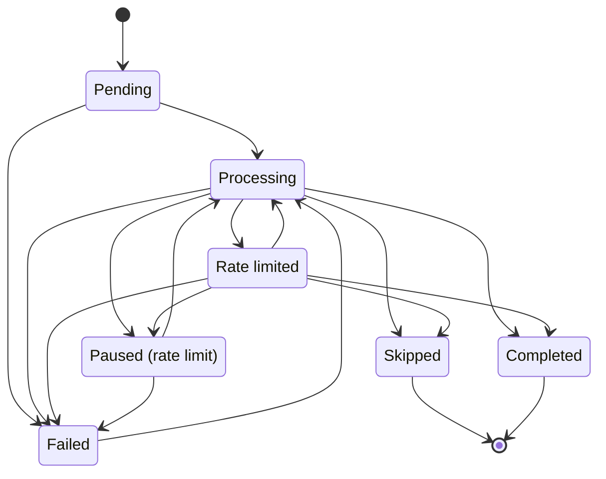

## interview-round

- **Id:** `interview-round`
- **Persisted in:** `interview-prep/sessions/*.md (round: frontmatter) + interview-prep/{company}-{role}.md (Audience Map)`
- **Initial state:** `Screen`
- **Writers:** `modes/interview/debrief.md`, `modes/interview/practice.md`, `modes/interview-prep.md`
- **Policy:** `backward_between_live=correction`, `exit_terminal=force`, `unknown_input=flag`

### States

| Id | Label | Terminal | Aliases | Description |
|----|-------|----------|---------|-------------|
| `screen` | `Screen` | no | `recruiter-screen`, `screening` | First call, recruiter / HR / TA (15-30 min). Fit gate - motivation, comp, location/visa, timeline. |
| `hiring-manager` | `Hiring manager` | no | (none) | Manager or skip-level conversation (30-45 min). Why this role, scope alignment, leadership signals. |
| `technical` | `Technical` | no | `peer-tech` | IC technical round (live coding, domain depth, take-home review). `peer-tech` is the interview-prep audience spelling. |
| `system-design` | `System design` | no | `design-case-study` | Design / case-study round. |
| `behavioral` | `Behavioral` | no | (none) | Behavioral round. |
| `onsite` | `Onsite` | no | `panel-mixed` | Onsite / loop with several interviewer types in one block. `panel-mixed` is the interview-prep audience spelling. |
| `final` | `Final` | yes | (none) | Final round. |

### Transitions

- `Screen` → `Hiring manager`, `Technical`
- `Hiring manager` → `Technical`, `Onsite`, `Final`
- `Technical` → `System design`, `Behavioral`, `Hiring manager`, `Onsite`, `Final`
- `System design` → `Behavioral`, `Onsite`, `Final`
- `Behavioral` → `Onsite`, `Final`
- `Onsite` → `Final`
- `Final` → (terminal: no outgoing transitions)

### Diagram

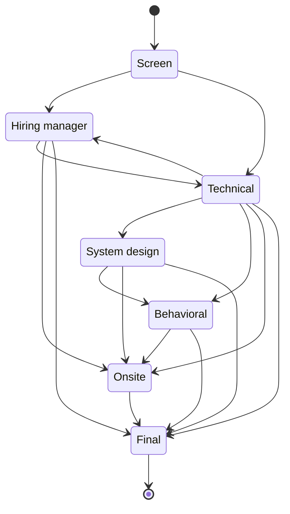

## interview-round-outcome

- **Id:** `interview-round-outcome`
- **Persisted in:** `interview-prep/{company}-{role}.md (debrief **Outcome:** line)`
- **Initial state:** `Pending`
- **Writers:** `modes/interview/debrief.md`
- **Policy:** `backward_between_live=correction`, `exit_terminal=force`, `unknown_input=flag`

### States

| Id | Label | Terminal | Aliases | Description |
|----|-------|----------|---------|-------------|
| `pending` | `Pending` | no | `offen`, `pendiente`, `pendente`, `en attente` | Outcome of the round not known yet. |
| `moved-forward` | `Moved forward` | yes | `moved forward`, `weiter`, `avanzó`, `avançou`, `avance` | Candidate advances to the next round. |
| `rejected` | `Rejected` | yes | `abgelehnt`, `rechazado`, `rejeitado`, `rejeté` | Candidate is out of the process. |

### Transitions

- `Pending` → `Moved forward`, `Rejected`
- `Moved forward` → (terminal: no outgoing transitions)
- `Rejected` → (terminal: no outgoing transitions)

### Diagram

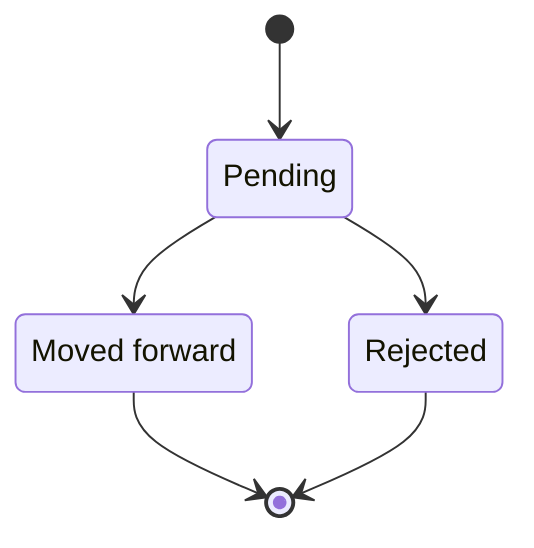

## legitimacy-tier

- **Id:** `legitimacy-tier`
- **Persisted in:** `reports/*.md (**Legitimacy:** header + Machine Summary legitimacy_tier / risk_summary.legitimacy)`
- **Initial state:** `Unconfirmed`
- **Writers:** `openrouter-runner.mjs`, `eval-runner.mjs`, `gemini-eval.mjs`, `ollama-eval.mjs`, `openai-eval.mjs`, `batch/batch-prompt.md`
- **Policy:** `backward_between_live=correction`, `exit_terminal=force`, `unknown_input=flag`

### States

| Id | Label | Terminal | Aliases | Description |
|----|-------|----------|---------|-------------|
| `unconfirmed` | `Unconfirmed` | no | `unknown` | NOT a tier. Fallback written when no tier was assessed. Since D13 every writer emits `unconfirmed`: openrouter-runner.mjs (LLM output lacked a **Legitimacy:** line) and eval-runner.mjs parseScoreSummary (no SCORE_SUMMARY block, or no LEGITIMACY: line). `unknown` was eval-runner's old spelling; it stays a declared alias so reports written before D13 still resolve. analyze-patterns.mjs stores the string as-is, so old `unknown` reports still group apart from new ones. modes/oferta.md says "default to Proceed with Caution" when posting age is unknown — that is a TIER decision and does not use this state. |
| `high-confidence` | `High Confidence` | no | `high_confidence`, `Güvenilir`, `Висока впевненість`, `高置信度`, `高信心`, `ثقة عالية` | Real, active opening (most signals positive). Block G tier. |
| `proceed-with-caution` | `Proceed with Caution` | no | `proceed_with_caution`, `Dikkatli İlerle`, `Обережно`, `谨慎推进`, `審慎推進`, `تقدم بحذر` | Mixed signals worth noting. Block G tier; also the documented default when posting age is unknown. |
| `suspicious` | `Suspicious` | no | `Şüpheli`, `Підозріло`, `疑似虚假`, `疑似虚假/已过期`, `疑似虛假`, `疑似虛假／已過期`, `مشبوهة` | Multiple ghost-job indicators; investigate before investing time. Block G tier. Language drift: the zh and zh-TW _shared.md labels add "/已过期" ("or expired"), so those modes bucket expired postings with suspected ghosts; the English tier is about ghost indicators only. |

### Transitions

- `Unconfirmed` → `High Confidence`, `Proceed with Caution`, `Suspicious`
- `High Confidence` → (terminal: no outgoing transitions)
- `Proceed with Caution` → (terminal: no outgoing transitions)
- `Suspicious` → (terminal: no outgoing transitions)

### Diagram

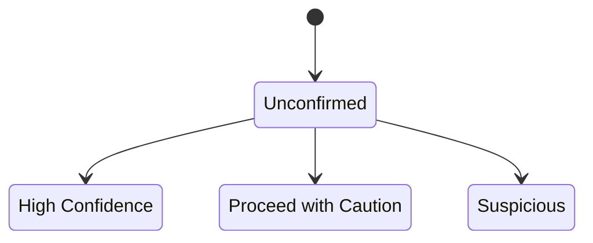

## pdf-flag

- **Id:** `pdf-flag`
- **Persisted in:** `data/applications.md (PDF column) ; source of truth for "generated" is data/pdf-index.tsv`
- **Initial state:** `Missing`
- **Writers:** `merge-tracker.mjs`, `sync-pdf-flags.mjs`, `batch/batch-prompt.md`, `tracker.mjs`, `generate-pdf.mjs`
- **Policy:** `backward_between_live=forbidden`, `exit_terminal=forbidden`, `unknown_input=flag`

### States

| Id | Label | Terminal | Aliases | Description |
|----|-------|----------|---------|-------------|
| `missing` | `Missing` | no | `❌` | No PDF generated when the row was written (batch worker with score below the PDF threshold, manual add, or tracker.mjs default for an empty cell) |
| `not-applicable` | `Not applicable` | no | `—`, `-` | No PDF expected or no data (backfilled/legacy rows). merge-tracker never upgrades it; sync-pdf-flags does. outcome.mjs treats both the em dash and the hyphen as "no PDF path" |
| `generated` | `Generated` | yes | `✅` | A PDF for the row's report exists in data/pdf-index.tsv (written by generate-pdf.mjs). One-way; nothing downgrades it |

### Transitions

- `Missing` → `Generated`
- `Not applicable` → `Generated`
- `Generated` → (terminal: no outgoing transitions)

### Diagram

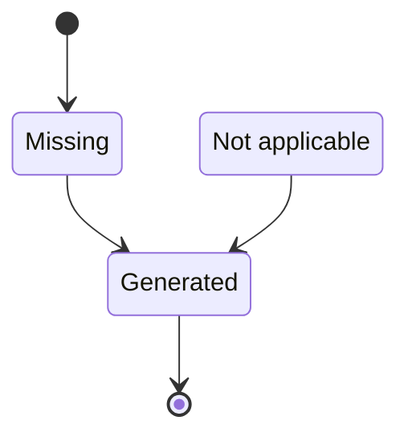

## portal-health

- **Id:** `portal-health`
- **Persisted in:** `data/portal-health.tsv (status column; one row per company per scan run)`
- **Initial state:** `Unprobed`
- **Writers:** `scan.mjs`
- **Policy:** `backward_between_live=correction`, `exit_terminal=force`, `unknown_input=map:unknown`

### States

| Id | Label | Terminal | Aliases | Description |
|----|-------|----------|---------|-------------|
| `unprobed` | `Unprobed` | no | `skipped`, `unverified`, `none` | No health record yet, or a probe that produced no signal (provider-health `skipped`, discover-ats `unverified`/`none`). Never written to portal-health.tsv. Neutral in spirit; a string like this read from the log would count as a failure today |
| `reachable` | `Reachable` | no | `live`, `healthy`, `match` | The board answered and returned jobs. HEALTHY class, resets the streak. Aliases are verify-portals `live` (also its partial:true probes), provider-health `healthy`, discover-ats `match` |
| `empty` | `Empty` | no | (none) | The board answered but lists 0 jobs (scan.mjs:2624 downgrades reachable to empty). HEALTHY class, resets the streak; a live board with no openings is reachable. Same spelling in verify-portals and discover-ats |
| `rate_limited` | `Rate limited` | no | (none) | HTTP 429. NEUTRAL class in scan.mjs and stats.mjs (neither extends nor resets the streak) |
| `slug_gone` | `Slug gone` | no | `missing` | HTTP 404/410, the board slug no longer exists (classifyFetchError). FAILURE class. verify-portals `missing` is the same idea (no board found for the slug) |
| `network` | `Network error` | no | `down` | Abort, timeout, ECONNREFUSED, ENOTFOUND, ETIMEDOUT, fetch failed. FAILURE class. provider-health `down` (timeout, refused, DNS, no response) is the same idea |
| `auth` | `Auth blocked` | no | (none) | HTTP 401/403, typically a WAF blocking the scanner. FAILURE class; recorded as `auth` (before the fix these were logged as healthy forever) |
| `server` | `Server error` | no | `degraded` | HTTP 5xx. FAILURE class. LOSSY alias provider-health `degraded` (API answered but slow >= 3s, or non-2xx) -- a slow 2xx is not a server error, but both mean "answering, unhappy" and both would count as a failure here |
| `unknown` | `Unknown error` | no | `error` | Any error classifyFetchError cannot place. FAILURE class, and also the bucket every unrecognised string falls into today. discover-ats `error` maps here |

### Transitions

- `Unprobed` → `Reachable`, `Empty`, `Rate limited`, `Slug gone`, `Network error`, `Auth blocked`, `Server error`, `Unknown error`
- `Reachable` → `Empty`, `Rate limited`, `Slug gone`, `Network error`, `Auth blocked`, `Server error`, `Unknown error`
- `Empty` → `Reachable`, `Rate limited`, `Slug gone`, `Network error`, `Auth blocked`, `Server error`, `Unknown error`
- `Rate limited` → `Reachable`, `Empty`, `Slug gone`, `Network error`, `Auth blocked`, `Server error`, `Unknown error`
- `Slug gone` → `Reachable`, `Empty`, `Rate limited`, `Network error`, `Auth blocked`, `Server error`, `Unknown error`
- `Network error` → `Reachable`, `Empty`, `Rate limited`, `Slug gone`, `Auth blocked`, `Server error`, `Unknown error`
- `Auth blocked` → `Reachable`, `Empty`, `Rate limited`, `Slug gone`, `Network error`, `Server error`, `Unknown error`
- `Server error` → `Reachable`, `Empty`, `Rate limited`, `Slug gone`, `Network error`, `Auth blocked`, `Unknown error`
- `Unknown error` → `Reachable`, `Empty`, `Rate limited`, `Slug gone`, `Network error`, `Auth blocked`, `Server error`

### Diagram

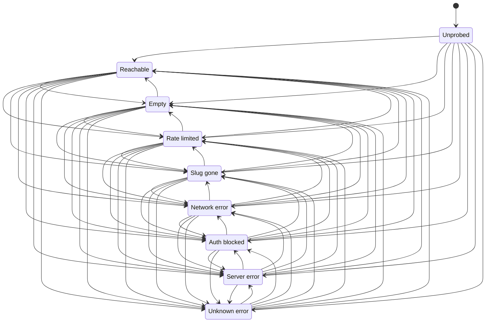

## red-flag-level

- **Id:** `red-flag-level`
- **Persisted in:** `prose only: modes/interview-redflag.md`
- **Initial state:** `None`
- **Writers:** `interview-redflag`
- **Policy:** `backward_between_live=forbidden`, `exit_terminal=forbidden`, `unknown_input=reject`

### States

| Id | Label | Terminal | Aliases | Description |
|----|-------|----------|---------|-------------|
| `none` | `None` | yes | `No structural red flags detected` | Red-flag score 0-1. No structural red flags detected |
| `caution` | `Caution` | yes | `Enter with eyes open` | Red-flag score 2-3. Shown as the emoji plus "Enter with eyes open" |
| `warning` | `Warning` | yes | `Reconsider` | Red-flag score 4 or more. Shown as the emoji plus "Reconsider"; the blacklist-suggestion sub-block applies |

### Transitions

- `None` → (terminal: no outgoing transitions)
- `Caution` → (terminal: no outgoing transitions)
- `Warning` → (terminal: no outgoing transitions)

### Diagram

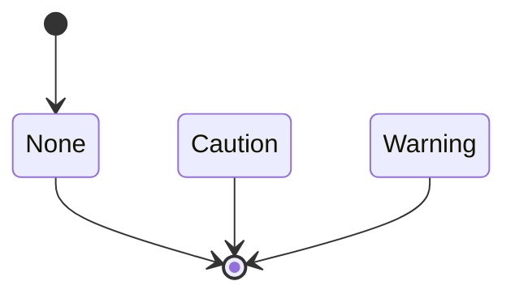

## reply-candidate

- **Id:** `reply-candidate`
- **Persisted in:** `data/reply-candidates.json (entry exists = pending; classification and applied are never persisted)`
- **Initial state:** `Pending`
- **Writers:** `reply-watch.mjs`, `paste-reply.mjs`
- **Policy:** `backward_between_live=correction`, `exit_terminal=force`, `unknown_input=flag`

### States

| Id | Label | Terminal | Aliases | Description |
|----|-------|----------|---------|-------------|
| `pending` | `Pending` | no | (none) | Entry present in data/reply-candidates.json, not yet classified in this run. EVERY entry is back here on every run (no persisted state). Optional `signal` on the entry - interview_invite, offer, rejection, update, or null - is a classifier hint only. Matching to a tracker row (reply-matcher matchCandidates) is a separate, unpersisted step with its own outcomes (confidence high/medium/low, no-match, ambiguous-match). |
| `noise` | `Noise` | no | (none) | classifyReply type Noise (job alerts, newsletters, invitations to apply). Suggested tracker update `none`; checked before every other type |
| `rejected` | `Rejected` | no | (none) | classifyReply type Rejected (signal rejection or rejection wording). Decided before Offer so "unable to offer" cannot become an Offer. Suggests tracker status Rejected |
| `offer` | `Offer` | no | (none) | classifyReply type Offer (signal offer or specific offer phrases). Suggests tracker status Offer |
| `auto-confirmation` | `Auto-confirmation` | no | (none) | classifyReply type Auto-confirmation (application received, automatic reply). Suggested tracker update `none` |
| `need-action` | `Need Action` | no | (none) | classifyReply type Need Action (assessment, form, deadline). Suggests tracker status Interview when scheduling wording is present, otherwise Responded |
| `interview` | `Interview` | no | (none) | classifyReply type Interview (signal interview_invite or interview wording). Suggests tracker status Interview |
| `responded` | `Responded` | no | (none) | classifyReply type Responded (signal update or generic "would like to chat" wording). Suggests tracker status Responded |
| `unknown` | `Unknown` | no | (none) | classifyReply type Unknown. Suggested tracker update is the literal `Needs Review`, which is NOT a tracker status and is never applied |
| `applied` | `Applied` | yes | (none) | The operator answered y to the review prompt and updateTrackerStatuses wrote the suggested status to the tracker (and the status ledger). Nothing is recorded on the candidate, so the next run re-classifies it; it is a no-op then only because the tracker row already holds the status |

### Transitions

- `Pending` → `Noise`, `Rejected`, `Offer`, `Auto-confirmation`, `Need Action`, `Interview`, `Responded`, `Unknown`
- `Noise` → (terminal: no outgoing transitions)
- `Rejected` → `Applied`
- `Offer` → `Applied`
- `Auto-confirmation` → (terminal: no outgoing transitions)
- `Need Action` → `Applied`
- `Interview` → `Applied`
- `Responded` → `Applied`
- `Unknown` → (terminal: no outgoing transitions)
- `Applied` → (terminal: no outgoing transitions)

### Diagram

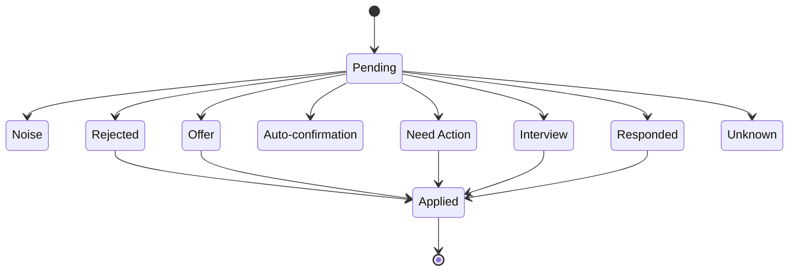

## scan-history

- **Id:** `scan-history`
- **Persisted in:** `data/scan-history.tsv (status column, col 6)`
- **Initial state:** `added`
- **Writers:** `scan.mjs`, `scan-ats-full.mjs`, `scan-interamt.mjs`, `openrouter-runner.mjs`
- **Policy:** `backward_between_live=correction`, `exit_terminal=force`, `unknown_input=flag`

### States

| Id | Label | Terminal | Aliases | Description |
|----|-------|----------|---------|-------------|
| `added` | `added` | no | (none) | The URL was surfaced to pipeline.md. The ONLY status that can lapse, and only when scan_history.recheck_after_days is set and the row is older than that. Blank/missing status reads as this |
| `skipped_expired` | `skipped_expired` | yes | (none) | --verify (or the scan agent) judged the posting dead, or its URL was migrated by --rediscover-404. Deduped permanently, even with recheck_after_days set. A false positive here never self-heals |
| `skipped_no_apply_control` | `skipped_no_apply_control` | yes | (none) | --verify loaded the page but found no Apply control. Dropped from pipeline.md; deduped permanently (same flaw as skipped_expired) |
| `skipped_invalid_url` | `skipped_invalid_url` | yes | (none) | URL guard rejection (invalid_url or unsupported_protocol). Deduped permanently |
| `skipped_blocked_host` | `skipped_blocked_host` | yes | (none) | URL guard rejection (private or blocked host). Deduped permanently |
| `skipped_title` | `skipped_title` | yes | (none) | Filtered by the title filter. Written by scan-interamt.mjs and the scan agent mode, not by scan.mjs. Deduped permanently |
| `skipped_location` | `skipped_location` | yes | (none) | Filtered by location. Written by scan-interamt.mjs only. Deduped permanently |
| `skipped_date` | `skipped_date` | yes | (none) | Published before the last scan. Written by scan-interamt.mjs only. Deduped permanently |
| `skipped_dup` | `skipped_dup` | yes | (none) | Duplicate offer. Written by scan-interamt.mjs and the scan agent mode. Deduped permanently |
| `cooldown` | `cooldown` | no | (none) | Written as the PATTERN `cooldown:<company>:<YYYY-MM-DD>` (scan.mjs:~780,798, grouped at ~2462), never the bare word; the registry cannot match a pattern, so canonicalize the text before the first colon. Deduped only while today is before the date, then the URL is eligible again |

### Transitions

- `added` → `skipped_expired`, `skipped_no_apply_control`, `skipped_invalid_url`, `skipped_blocked_host`, `cooldown`
- `skipped_expired` → (terminal: no outgoing transitions)
- `skipped_no_apply_control` → (terminal: no outgoing transitions)
- `skipped_invalid_url` → (terminal: no outgoing transitions)
- `skipped_blocked_host` → (terminal: no outgoing transitions)
- `skipped_title` → (terminal: no outgoing transitions)
- `skipped_location` → (terminal: no outgoing transitions)
- `skipped_date` → (terminal: no outgoing transitions)
- `skipped_dup` → (terminal: no outgoing transitions)
- `cooldown` → `added`, `skipped_expired`, `skipped_no_apply_control`, `skipped_invalid_url`, `skipped_blocked_host`

### Diagram

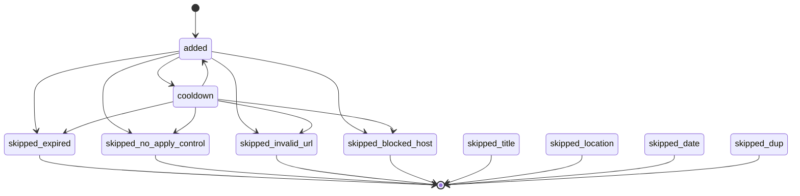

## triage-verdict

- **Id:** `triage-verdict`
- **Persisted in:** `prose only: modes/triage.md`
- **Initial state:** `PASS`
- **Writers:** `triage`
- **Policy:** `backward_between_live=forbidden`, `exit_terminal=forbidden`, `unknown_input=reject`

### States

| Id | Label | Terminal | Aliases | Description |
|----|-------|----------|---------|-------------|
| `pass` | `PASS` | yes | (none) | Score at or above triage_threshold (default 3.5). Proceed to the full A-G evaluation. A company on the Priority Override List always gets PASS |
| `marginal` | `MARGINAL` | yes | (none) | Score from 3.0 up to threshold minus 0.1. One-liner shown to the user; skip the full evaluation unless the user overrides |
| `fail` | `FAIL` | yes | (none) | Score below 3.0. A clear no-go; return the line and stop |
| `skip` | `SKIP` | yes | (none) | Posting inaccessible or expired (score N/A). Return the line and stop |

### Transitions

- `PASS` → (terminal: no outgoing transitions)
- `MARGINAL` → (terminal: no outgoing transitions)
- `FAIL` → (terminal: no outgoing transitions)
- `SKIP` → (terminal: no outgoing transitions)

### Diagram

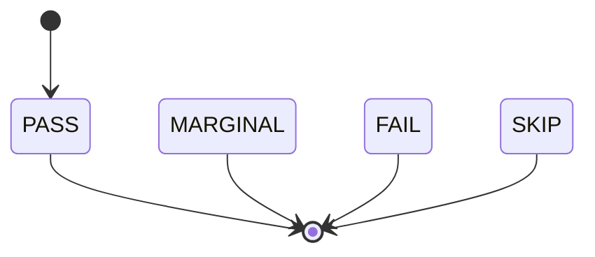
